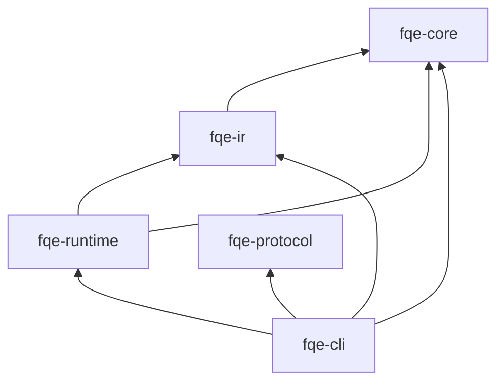

# Architecture

Status: the Rust foundation is implemented; its IR and runtime APIs are experimental. Workers, external transports, plugins, and execution services are planned.

Product authority: [Charter](PROJECT_CHARTER.md). Technical direction: [ADRs](ARCHITECTURE_DECISIONS.md). Current facts: [Audit](BASELINE_AUDIT.md) and [Project status](PROJECT_STATUS.md). Universal graph/workflow/state targets: [P1 design](P1_STRATEGY_DESIGN.md). This overview does not replace those scoped authorities.

## Product boundary

Finger Quant Engine is an independent, language-neutral local engine. Strategy computation, replay, simulation, and parameter search belong on the user's device. Neither a hosted compute service nor a Finger Trader account is a prerequisite for offline use.

Rust is the implementation language of the authoritative core, not a restriction on strategy authoring. The typed Strategy IR is intended to express a portable subset with explicit types and deterministic semantics. Planned Python, Java, and Go workers provide language adapters without redefining event, state, or execution contracts.

Flutter Desktop is one optional client. It may orchestrate a local engine, inspect state, and present results. FQE must remain usable from its CLI and future SDKs without Flutter. Trading API connectivity belongs to the independent Finger Trader Trading SDK and a future explicit adapter; a signal has no authority to place an order.

## Implemented dependency graph



Arrows mean Cargo dependency. The protocol crate has no dependency on the runtime and no generated bindings. The CLI uses its draft version constant for diagnostics; events in the demo do not travel over Protocol Buffers.

| Crate | Responsibility | Excluded responsibility |
| --- | --- | --- |
| fqe-core | Validated instrument IDs, positive integer prices, input events, signal values | UI, network, accounts, execution |
| fqe-ir | Version validation, typed price expressions, stateless rule evaluation | Arbitrary language parsing or execution |
| fqe-runtime | One-shot ordered event consumption, lifecycle, signal provenance | Accounting, async scheduling, durable jobs |
| fqe-protocol | Draft schema source and version-number compatibility helper | Serialization, RPC, IPC server |
| fqe-cli | Offline demonstration, help, version, process exit codes | Strategy file ingestion, backtest command, service daemon |

The current dependency graph contains only workspace path dependencies and Rust's standard library. There are no Cargo build scripts or native extensions.

## Implemented data flow

The CLI constructs a validated typed strategy and a synthetic event list. The runtime validates event order, evaluates the strategy, updates in-memory state, and returns a report of signals. There is no implicit clock, filesystem read, market-data subscription, or account lookup.

The runtime's only current payload is a market tick. A comparison can emit a long or flat observation for each matching tick. These labels do not create or modify a position.

## Planned architecture

The intended boundary is:

```text
CLI / optional Flutter Desktop / other local clients
                     |
        versioned local FFI / IPC boundary (to evaluate)
                     |
      Rust host: validation, event order, state
          |                  |
  typed IR interpreter   supervised local language workers
          |
  local datasets / backtest / simulator / optimizer
          |
  optional execution adapter -> independent Trading SDK
```

All compute boxes are local. A worker may evaluate a strategy in its own process; the host remains responsible for sequencing and validating outputs. There are two prospective authoring paths: compile a supported declarative subset into typed IR, or execute an imperative strategy through a worker contract. Arbitrary Python/Java/Go programs cannot be assumed to translate into the IR or to be mutually deterministic.

The portable strategy target combines Typed Graph + Event Workflow + State Machine. Registered indicator functions feed universal expressions; explicit State/Delay mediates cross-event feedback. These are P1/P2 targets, not implemented baseline extensions. Language workers deliver Python, then Java, then Go in P5. Numeric representation, Protobuf codec, transport and plugin execution remain open choices in the ADR register.

Future adapters must make external data access and execution authority explicit. Offline operations may use local data and stub adapters without login. Live connectivity can require network access and user credentials without changing offline engine eligibility.

## Cross-cutting decisions

- Version engine releases, IR semantics, wire protocol, and future plugin APIs separately.
- Keep domain semantics independent of transports and client presentation.
- Use explicit price scales, timestamps, seeds, and dataset identities before financial replay is introduced.
- Validate at every trust boundary; Rust type safety alone cannot validate an incoming protobuf message.
- Do not treat a process boundary as a sandbox. User strategies and plugins are untrusted code.
- Add persistence, cancellation, resource budgets, and fault isolation before claiming a production runtime.
- Preserve dependency direction. The core must never import Flutter, a worker language runtime, or broker-specific models.

See the [roadmap](ROADMAP.md) for gated implementation phases.
